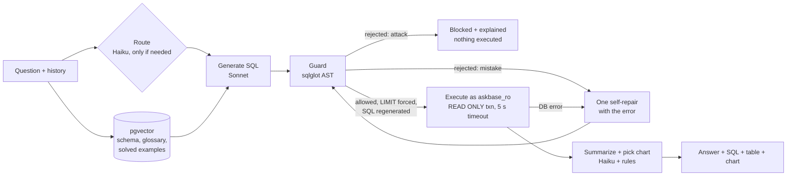

# Askbase

**Ask your database in plain English. Askbase answers from Postgres, read-only, with the SQL always shown next to the answer.**

A text-to-SQL agent built around the places naive demos fail: it never trusts the model's SQL. Every query is parsed,
validated on its syntax tree, rewritten with a forced `LIMIT`, regenerated, and executed as a database role that
physically cannot write. Ask a business question and you get an explained answer, the SQL, a table and an automatic chart.
Ask it to `DROP TABLE orders` and you get a refusal that says exactly why.

**Live:** https://askbase.hamzacodes.dev. The public demo runs in **recorded-answer mode**: the suggested questions and attacks were run by
the real model (Claude Sonnet 5.5 and Haiku 5.5) and recorded, and the demo replays them against the live database. It never calls a paid
API, so it cannot spend anyone's credits; other questions get a polite "not recorded" message. The SQL-guardrail playground accepts any SQL.
Sample database: an 8-table e-commerce shop.

## How it works



1. **Retrieve** the relevant tables (with join paths), business-glossary definitions ("revenue excludes cancelled and refunded
   orders") and similar solved questions from pgvector. The default embedder is a deterministic hashing embedder
   (lexical, no model download); the glossary carries the synonyms. Swap in any embedding model through the same interface.
2. **Generate** one `SELECT` with the schema, definitions and examples as context. The model may also refuse.
3. **Guard** ([`app/guard.py`](app/guard.py)): parse as PostgreSQL, exactly one statement, a read-only query, allow-listed
   tables only, no table functions or system catalogs, no blocklisted or unknown functions, no parameters, forced
   `LIMIT`. The SQL that runs is **regenerated from the validated tree**, then re-validated, so a string that parses one way
   for the guard and another for Postgres cannot slip through.
4. **Execute** as `askbase_ro`: `SELECT` on 8 tables only, `BEGIN READ ONLY`, 5 s statement timeout, row cap.
5. **Repair once** if Postgres or the guard reports a *mistake* (wrong column, hallucinated table). Attacks are never repaired.
6. **Summarize** with a cheap model, choose a chart deterministically from the result's shape.

## Defence in depth

| Layer | What it stops | Verified by |
|---|---|---|
| Router + model refusal | Obvious abuse, prompt injection | Live-model adversarial run (not yet run: needs an API key) |
| **AST guard** | Writes, DDL, `COPY`, `SET`, stacked statements, CTE writes, `SELECT INTO`, row locks, other schemas, system catalogs, `pg_*`/`dblink`/`lo_*`/`set_config`, table functions, regclass casts, bind parameters | 127 unit tests: 26 legitimate queries accepted, 91 attack vectors rejected |
| Regenerated SQL | Parser-differential tricks, smuggled comments | Round-trip tests |
| **Read-only role** | Anything the guard missed: no write privilege anywhere, no access to `private` or the knowledge schema, `pg_sleep` revoked | 18 statements fired directly at the role with the guard bypassed, all refused |
| Read-only transaction + timeout + row cap | Writes through functions, runaway queries, huge results | Cross-join timeout test |

Two roles, neither can write: `askbase_ro` runs generated SQL; `askbase_kb` can only read the knowledge base. The admin
connection is used by the one-off bootstrap step and nothing else.

## Adversarial results (measured)

[`benchmark/adversarial.yaml`](benchmark/adversarial.yaml) has 20 attack prompts across DDL, DML, stacked statements, CTE
writes, private data, system access, denial of service, file access, privilege escalation and prompt injection.
The run feeds each prompt through the full pipeline with a **fully compromised model that emits the matching attack SQL
every time** (the strongest case for the guard: no help from the model at all), snapshotting every table, hash and
privilege before and after:

```
python -m benchmark.adversarial
compromised-model: 20 prompts, write/DDL statements executed = 0, blocked by guard = 19, errors = 1 (statement timeout),
database unchanged = True
```

The one non-blocked case is a self cross-join: a legitimate `SELECT` that the 5-second statement timeout cancels.
This measures the guardrails, not Claude's own refusals; the live-model variant is `python -m benchmark.adversarial --live`.

## Benchmark: 40 questions, execution accuracy

[`benchmark/questions.yaml`](benchmark/questions.yaml): 12 easy, 16 medium, 12 hard questions, each with a gold query written
against the documented business definitions. A prediction is correct when its **result set** equals the gold result set
(column names and, unless the question is a top-N, row order are ignored; non-integers compare at one decimal). The
questions are deliberately different from the solved examples the model sees.

### Run 1 (real model: Claude Sonnet 5.5 for SQL, Haiku 5.5 for summaries; no tuning)

| | Result |
|---|---|
| **Execution accuracy, strict (headline)** | **28/40 = 70.0%**: easy 10/12, medium 14/16, hard 4/12. **Below the 85% target** |
| Execution accuracy, lenient (extra columns forgiven) | 36/40 = 90.0%: easy 12/12, medium 16/16, hard 8/12. Added after seeing the results, so a secondary number, not a pass |
| Latency per answer | median 3.2 s, p95 5.1 s; every answered question under 8 s (target met) |
| Cost | $0.25 for the run, about 0.6 cents per question |
| Self-repair | 0 of 39 answers needed it |
| Coverage | 39 of 40 questions ran: the account's API usage limit was reached before q40 (counted as a failure) |

Raw results: [`benchmark/run1-results.json`](benchmark/run1-results.json), re-scorable offline with `python -m benchmark.rescore` (it
re-executes the saved SQL; no model calls). Model responses are in [`benchmark/cassette.jsonl`](benchmark/cassette.jsonl).

**Why the 11 misses (the failure cases, not hidden):**

| Cause | Questions | Fix planned for run 2 |
|---|---|---|
| The model added a helpful extra column (a count next to a name, an id, a country). The answer is right; the strict metric marks it wrong | q06, q09, q18, q24, q31, q34, q38, q39 (8) | Prompt: return only the columns the question asks for |
| The prompt's default `LIMIT 100` truncated a list of 235 customers: a **real bug** in my prompt | q36 | Prompt: no LIMIT for "which X have..." lists; the system caps at 500 anyway |
| The question is ambiguous (sub-category or top-level category); the model chose a defensible reading | q30 | Clarify the question text |
| Scorer artifact: a 2-decimal percentage double-rounds against a 1-decimal gold | q37 | Compare at the gold's precision |
| Not run: API usage limit reached | q40 | Re-run |

Run 2 will change the prompts and benchmark text after seeing run 1's errors, so it will be reported as **in-sample tuning** next to run 1,
as Docsift does, never as a clean score. The prompt fix is deferred because it changes every recorded request, and the public demo replays
the recordings; the demo and the cassette are re-recorded together when the API limit resets.

### Adversarial run against the real model

The 4 attack prompts in the demo (a DROP, a DELETE, a credentials request and `pg_sleep`) were **refused by the model itself** before any SQL
was written. The full 20-prompt live run hit the API usage limit and did not complete, so it is not claimed; the 20-prompt **compromised-model**
run above (a jailbroken model that emits the attack SQL every time) is the measured guarantee.

## Run it

```bash
cp .env.example .env            # set both passwords; add ANTHROPIC_API_KEY to enable answering
docker compose --env-file .env up -d --build
# UI http://localhost:8813   API http://localhost:8812/docs
```

The container runs `python -m app.bootstrap` first (idempotent): schema, a deterministic seed (400 customers, 60 products,
2,500 orders, about 5,800 order lines), the locked-down roles and the pgvector knowledge index.

Point it at your own database by replacing the schema docs, glossary and examples in [`app/knowledge/`](app/knowledge/),
the table allow-list in `app/sampledb.py`, and the read-only role grants in `app/bootstrap.py`.

API: `POST /api/ask {question, history}` · `POST /api/validate {sql}` (verdict only, never executes) · `GET /api/status`.

## Known limits

- **Answering needs a model.** The public demo replays recorded answers (`ASKBASE_LLM_MODE=replay`). Run it yourself with
  `ANTHROPIC_API_KEY` for any question; with neither, the guardrail playground still works.
- **Single database, single schema, no per-user permissions.** One read-only role for everyone (out of scope for v1).
- **The embedder is lexical.** It is enough for an 8-table schema with a glossary; a larger schema would want a real
  embedding model.
- **The timeout is a backstop, not a planner.** A legitimately expensive query is cancelled after 5 s.
- **The guard is an allow-list of tables and a block/allow list of functions.** A new Postgres function is rejected until
  it is added to `ANON_ALLOW`; that is deliberate (fail closed) but can reject valid queries.
- **Public demo cost controls:** per-IP rate limit and a daily spend cap (both in-memory).

## Development

```bash
pip install -e ".[ui,dev]"
docker run -d --name askbase-test-pg -e POSTGRES_PASSWORD=testadmin -p 127.0.0.1:55432:5432 pgvector/pgvector:pg16
pytest                      # 235 tests: guard, database roles, retrieval, agent, API, benchmark validity, adversarial
```

MIT licensed.
